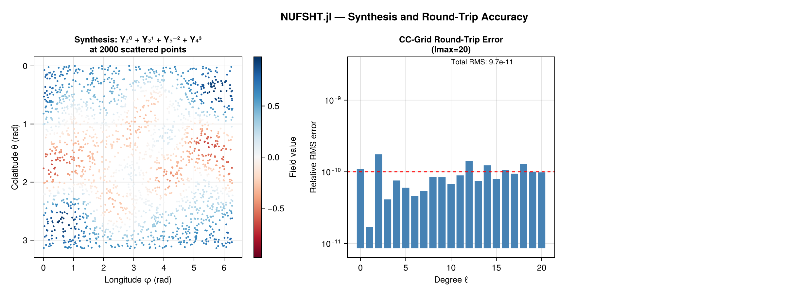
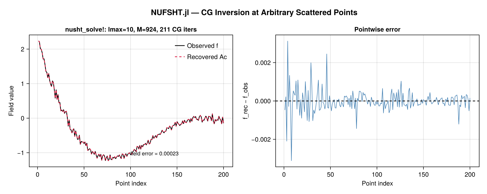
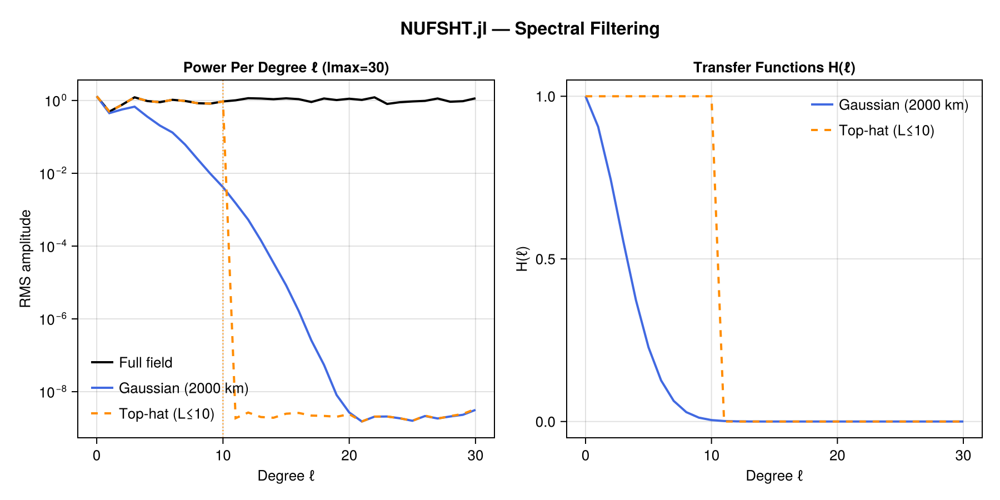
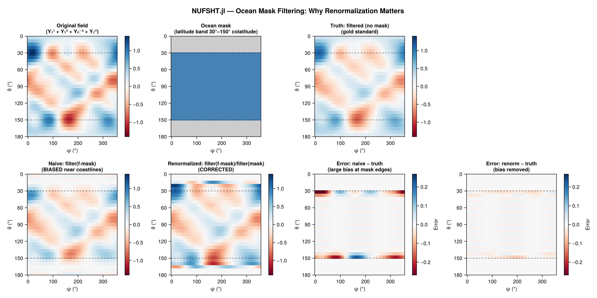
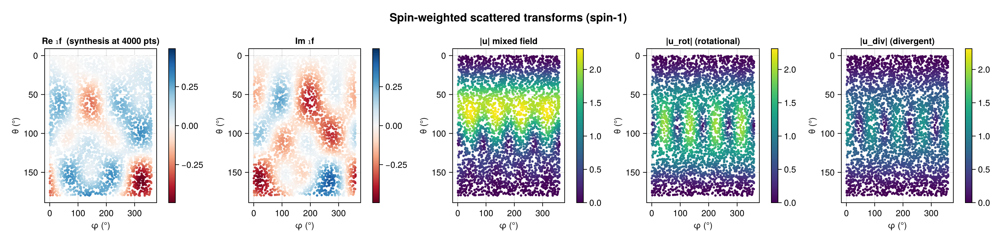

# NUFSHT.jl

[](https://github.com/jbphyswx/NUFSHT.jl/actions/workflows/CI.yml)
[](https://jbphyswx.github.io/NUFSHT.jl/dev/)
[](https://codecov.io/gh/jbphyswx/NUFSHT.jl)

**Non-Uniform Fast Spherical Harmonic Transforms** — native Julia implementation of the
Double Fourier Sphere (DFS) + NUFFT algorithm for computing spherical harmonic transforms
at arbitrary scattered (colatitude, longitude) points on the sphere.

## Results

### Synthesis at Scattered Points + Round-Trip Accuracy



### Inversion at Arbitrary Scattered Points



### Spectral Filtering (Gaussian and Sharp Cutoff)



### Ocean Mask + Renormalization



### Spin-weighted synthesis + spin-1 Hodge decomposition



## Spin-weighted transforms (spin-`s`)

NUFSHT also synthesizes/analyzes **spin-weighted** fields at arbitrary scattered points: the
spin-weighted coefficients become a bivariate Fourier series, by the ring S-step described under
[Algorithm](#algorithm), which a 2-D NUFFT evaluates, in the convention below.
Spin-1 is the tangent-vector case (a velocity `U = u_θ + i u_φ` is a spin-1 field), which enables
vector/Helmholtz decomposition on scattered spherical data.

```julia
using NUFSHT
lmax, s = 32, 1
θ = π .* rand(5000); φ = 2π .* rand(5000)          # scattered colatitude/longitude
plan = make_spin_plan(θ, φ, lmax, s)                # add ntrans=B for batches; ComplexF32 first arg for f32

# synthesis: spin-s coefficients -> complex field values at the points
sf = zeros(ComplexF64, lmax+1, 2lmax+1)             # spin-s coefficients (set some modes)
f  = zeros(ComplexF64, length(θ))
nusht_type2_spin!(f, sf, plan)

# exact inversion at arbitrary scattered points (LSMR on the bidiagonalization of A)
sf_rec = zeros(ComplexF64, lmax+1, 2lmax+1)
nusht_solve_spin!(sf_rec, f, plan; rtol=1e-9)
```

`make_spin_plan` / `nusht_type2_spin!` / `nusht_type1_spin!` (exact adjoint) /
`nusht_solve_spin!` / `nusht_analyze!`; coefficient indices via `spin_coeff_index(ℓ,m,lmax)`, direct
harmonic values via `sYlm(s,ℓ,m,θ,φ)`. Validated to ~1e-12 (synthesis), ~1e-15 (adjoint), and exact
scattered inversion. See `dev/spin_hodge_validation.jl` for the spin-1 Helmholtz/Hodge use.

The scalar plans use FastTransforms' real harmonics (no Condon–Shortley phase), the spin plans at
`s = 0` the complex `₀Y_ℓm = N_ℓ d^ℓ_{m0}(θ) e^{imφ}` (with it). `scalar_to_spin0!(sf, C)` and
`spin0_to_scalar!(C, sf)` convert between the two coefficient arrays, so both plans synthesize the same
field.

## Installation

```julia
using Pkg
Pkg.add(url="https://github.com/jbphyswx/NUFSHT.jl")
```

## Performance, batching, parallelism & GPU

Everything below is dependency-light by default — the accelerators are **package extensions**, loaded
only when you load their trigger package, so a plain `using NUFSHT` never pulls in MPI/CUDA/etc.

- **Persistent plans, zero allocation.** A plan builds its NUFFT plans once (points set once) and
  pre-allocates every buffer, so warmed-up `nusht_type2!`/`nusht_type1!` and the hundreds of solver
  matvecs inside `nusht_solve!` allocate **nothing** in NUFSHT's own code and never re-plan. The NUFFT
  comes from [FlowTransformBindings](https://github.com/jbphyswx/FlowTransformBindings.jl): at
  `nthreads = 1` a FINUFFT execution allocates nothing and a NonuniformFFTs one a fixed amount,
  independent of the point count.
- **`execution` and `nthreads`.** `make_plan(…; execution = SerialBackend())` runs a plan on one thread,
  `ThreadedBackend()` on `Threads.nthreads()`, and the default `AutoBackend()` at `nthreads`, whose own
  default is `Threads.nthreads()`. An explicit `nthreads` takes precedence over the count `execution`
  sets; with `SerialBackend()` any count other than `1` is an `ArgumentError`. The count covers the
  NUFFT and FastTransforms' OpenMP regions alike, and each FastTransforms call restores the OpenMP count
  it found.
- **`nthreads` is honoured or refused.** FINUFFT takes any count;
  direct summation splits the axis each direction writes and gives bit-identical output at any count;
  NonuniformFFTs parallelises over Julia's threads and so reaches `1` (serial spreading) and
  `Threads.nthreads()`, raising an error for any other count. Use `nthreads = 1` when two runs must agree
  bit for bit: a multi-threaded type 1 (the adjoint) can differ in the last bit between runs on both
  libraries, while type 2 and every single-threaded transform return the same bits.
- **Batching (`ntrans = B`).** Transform `B` co-located fields (same points) in one call —
  `make_plan(θ, φ, lmax; ntrans = B)`, coefficients/fields carry a trailing batch axis. FFTW and
  FINUFFT parallelize *across the batch* internally, the recommended way to use many cores on one node.
- **Real and complex fields.** The field element type is the first (optional) positional argument, as
  it is for `zeros`: `make_plan(Float64, θ, φ, lmax)` for a real field, `make_plan(ComplexF64, …)` for
  a complex one; likewise `make_spin_plan(FE, θ, φ, lmax, s)`. Both compute the same transform — the
  real one additionally exploits the Hermitian symmetry a real field gives its spectrum, folding one
  mode axis in half.
  A real field's coefficients are Hermitian, so `nusht_solve_spin!` on a real-field plan fits the
  `(lmax+1)²` real degrees they have, a quarter of the unknowns of the full complex array. That
  subspace exists only at `s = 0`: conjugation maps spin `s` to spin `−s`, so no spin-`s ≠ 0` field is
  real and inverting one needs a complex plan. Synthesis and the adjoint are exact for a real element
  type at every `s`.
- **Only the directions you use.** `make_plan(…; directions = SynthesisOnly())` builds no analysis
  plan, so a caller that only synthesises holds no type-1 grid; `nusht_type1!` / `nusht_solve!` /
  `nusht_filter!` on such a plan raise. The default is `SynthesisAndAnalysis()`. Where a backend's plan carries no direction, both directions already share
  one object and the keyword costs nothing either way.
- **Knowing what a plan holds.** `plan_memory(plan)` returns the byte count of each field and the
  total — the coefficient array, the mode array, the strengths, the node set and the plan pools — so
  the memory of a configuration can be checked before committing to it.
- **Trading memory for speed.** Most of a plan's memory is the backend's oversampled grid, which
  `upsampfac` (σ) sizes. `tol`, σ and the kernel half-support trade against each other, so a lower σ
  meets the same tolerance on a smaller grid at a cost in spreading: `σ = 1.25` roughly halves the
  NUFFT's memory against the default `2.0`, slows synthesis, and leaves analysis slightly *faster*. Use
  it when a dataset does not otherwise fit.
- **Mixed precision.** `Float32` and `ComplexF32` are supported. The sphere plans FastTransforms
  provides are `Float64`/`ComplexF64` only, so single-precision scalar plans run their S-step through a
  double-precision slice buffer, and everything else, the ring S-step of single-precision spin plans
  included, runs at the requested precision.
- **Parallel extensions** (each keyed on its trigger package, selected by the `execution` keyword):
  - `using OhMyThreads` — thread-parallel over independent problems (one plan per task),
    `nusht_type2!(fs, Cs, plans; execution = ThreadedBackend())`.
  - `using Distributed` — farm independent problems across worker **processes** (`addprocs`), each
    worker at the thread count it was started with, `nusht_type2(θs, φs, Cs, lmax; execution =
    DistributedBackend())`; serial when there are none. `make_plan(…; execution = DistributedBackend())`
    divides one transform's points among the workers.
  - `using MPI` — point-decomposition: partition the `M` points across ranks; `A` needs no
    communication, `A†` and the point-space norm are `Allreduce`d. Either each rank passes its own
    plan with `nusht_solve!(C, f_local, plan, MPIBackend(; comm))`, or
    `make_plan(…; execution = MPIBackend())` divides the points itself.
  > FastTransforms runs its S-step in OpenMP regions. NUFSHT loads FlowTransformBindings first, which
  > on macOS selects the OpenMP runtime's thread-local mode (`KMP_GTID_MODE=2`) before FastTransforms
  > loads it, so calls from Julia tasks are exact; in a session that loaded FastTransforms earlier with
  > that variable unset, calls from tasks run on one OpenMP thread. A plan runs FastTransforms at its
  > own thread count, the OhMyThreads farm and the per-column loop's tasks on one thread each, a
  > Distributed worker at its own thread count.
- **GPU** (`using KernelAbstractions` with the device array package). The array-indexed steps (the
  ring S-step of every device spin plan and the per-column solver primitives) are KA `@kernel`s,
  **written once, run on any backend**; the ring S-step's FFTs are the device array package's
  (`AbstractFFTs` plans, CUFFT on `CuArray`). FlowTransformBindings builds the NUFFT on the nodes'
  device: NonuniformFFTs on their KernelAbstractions backend, FINUFFT as cuFINUFFT on `CuArray` nodes
  (`using CUDA, FINUFFT`). A device node set, or `execution = GPUBackend(b)` with host nodes, yields a
  device-resident plan (buffers `similar` to the nodes). The device kernels are validated against the
  CPU path on `JLArrays`; end-to-end GPU parity is in `test/gpu_cuda.jl`, to run on NVIDIA hardware.

## Algorithm

The transform writes the spherical harmonic expansion as a Double-Fourier-Sphere
bivariate Fourier series and evaluates that series with a NUFFT:

```
Type 2 (synthesis):   A  = N · F · S
Type 1 (adjoint):     A† = S† · F† · N†
```

| Step | Operation | Forward | Adjoint |
|------|-----------|---------|---------|
| **S** | SH coefficients → DFS bivariate Fourier series | `plan_sph2fourier` (P) | `P'` |
| **F** | cos/sin basis → complex exponential mode array | `_assemble_modes!` | `_assemble_modes_adjoint!` |
| **N** | NUFFT: evaluate the Fourier series at scattered points | type-2 NUFFT | type-1 NUFFT |

`plan_sph2fourier` produces the DFS series directly, so the pipeline has no equiangular grid and no
doubling. For order `m`, the θ basis is
`cos((i-1)θ)` when `|m|` is even and `sin(iθ)` when it is odd, which is the parity the glide
reflection encodes: the DFS extension of `Y_lm` in θ is `sin^|m|θ · Q(cosθ)`.

(The **spin** path's **S** is the ring S-step: for each order `m`, the degree sum
`Σ_ℓ ₛf_ℓm N_ℓ d^ℓ_{m,−s}(θ)` on `lmax + 2` or more equispaced colatitudes by the three-term
recurrence of `d^ℓ_{m,−s}` in `ℓ`, held in scaled form where it is exponentially small, then one FFT
per order gives its column of the bivariate Fourier series. The orders run on separate tasks, in the
plan's precision, with a relative error below `lmax eps` in Float32 and below `10⁻¹²` in Float64 at
lmax 1024.)

### The real fast path

The field element type is positional, as in `zeros(T, …)`, and it is a statement about the data:
`make_plan(Float64, …)` asserts the field **values** are real, which makes the mode array Hermitian in
`kθ`. Only the `kθ ≥ 0` half is then stored — on **every** backend, since halving the θ axis halves
the deconvolution and the upsampled FFT and leaves the interpolation alone. Both NUFFT libraries take
real strengths for it through FlowTransformBindings, so the spreading/interpolation halves as well:

```julia
make_plan(Float64,    θ, φ, lmax)   # kθ ≥ 0, real strengths
make_plan(ComplexF64, θ, φ, lmax)   # full array
```

With no `nufft` given, a plan takes the first loaded of NonuniformFFTs and FINUFFT, then direct
summation. A backend named with `nufft = FlowTransformBindings.FINUFFTBackend()`,
`FlowTransformBindings.NonuniformFFTsBackend()` or `SpectralBackends.DirectSumSpectralBackend()` is
used as given.

With a real-data transform the forward is free: writing the half and letting the complex-to-real
transform imply the conjugate is exact, no weights. Its **transpose** is not — the embedding
`Z[−k] = conj(Z[k])` is `ℝ`-linear but not `ℂ`-linear, so `A†` carries a factor `2` on every `kθ > 0`
row (`{1, 2, 2, …}`, one at `kθ = 0` because that row is its own partner). There is no third case at
the top: the θ axis has odd length `2·lmax+3` and so has no self-paired Nyquist row.

Direct summation has no real-data transform. Its half-height transform is complex, so the conjugate
half is implied by nothing and the same `{1, 2, 2, …}` is applied on the **forward** as well; a
per-point phase undoes the centered row labelling, and the field is the real part of the result.

### Adjoint, analysis and inverse

- **`nusht_type1!`** is `A†`, the exact Euclidean **transpose**, with no quadrature weights. At scattered
  points `A†A ≠ I`.

- **`nusht_analyze!`** gives the coefficients of a sampled field, for scalar and spin plans. With
  per-point quadrature `weights` it is `Σⱼ wⱼ fⱼ conj(Y_lm(xⱼ))`, one weighted adjoint transform, which is
  the expansion of a degree-`lmax` field when the rule integrates the product of two degree-`lmax`
  harmonics exactly (Gauss–Legendre colatitudes times `2lmax + 1` equispaced longitudes, for one).
  Without weights it is the least-squares fit of `nusht_solve!`.

- **`nusht_solve!`** inverts, by LSMR on the Golub–Kahan bidiagonalization of `A`.

> **Use `nusht_analyze!` with weights on a quadrature rule, and `nusht_solve!` (or `nusht_analyze!`
> without weights) at arbitrary scattered points.** On the grid of `FastSphericalHarmonics.sph_points`,
> `FastSphericalHarmonics.sph_transform` analyses a gridded field exactly.

## Accuracy

| Operation | Points | Error | Notes |
|-----------|--------|-------|-------|
| `nusht_type2!` | grid of `sph_points` (lmax=20) | ~1 × 10⁻¹³ | vs `sph_evaluate` |
| `nusht_type2!` | **Scattered** (lmax=4–20) | ~3 × 10⁻¹³ | vs direct `Σ c_lm Y_lm` |
| `A†` adjoint identity `⟨Ax,y⟩ = ⟨x,A†y⟩` | Scattered | ~1 × 10⁻¹⁵ | |
| `nusht_solve!` | Scattered, 4× overdetermined | coefficients ~1 × 10⁻¹¹ | see below |

Solver convergence depends on `cond(A)`, a property of the **point distribution** independent of
`lmax`. For the design matrix over the `l ≤ lmax` modes at fourfold overdetermination:

| Point set | `cond(A)` | Iterations to 10⁻¹⁰ |
|-----------|-----------|---------------------|
| Golden-angle (Fibonacci) lattice | ≈ 1.04 | ≈ 6 |
| i.i.d. area-uniform | 3 – 7 | ≈ 40 |
| Half the points in a small polar cap | 40 – 80 | O(100) |

An index-linked spiral (φ advancing 2π/M per point while θ sweeps pole to pole) winds only once and
is near-degenerate — `cond(A) ≈ 10⁸` at lmax = 10 — so the field is reproduced while the coefficients
are meaningless. Prefer a golden-angle lattice or i.i.d. points.

## Usage

### Synthesis at scattered points

```julia
using NUFSHT, FastSphericalHarmonics

lmax = 50
θ = rand(2000) .* π      # colatitudes in [0,π]
φ = rand(2000) .* 2π     # longitudes in [0,2π)
plan = make_plan(θ, φ, lmax; tol=1e-8)

# Set some SH coefficients
C = zeros(lmax+1, 2lmax+1)
C[sph_mode(2, 0)] = 1.0   # Y_2^0
C[sph_mode(3, 1)] = 0.5   # Y_3^1

# Type 2 (synthesis): coefficients → field values at scattered points
f = zeros(length(θ))
nusht_type2!(f, C, plan)
```

### Fitting coefficients on FastSphericalHarmonics' grid

```julia
using NUFSHT, FastSphericalHarmonics

lmax = 30
pts = sph_points(lmax + 1)          # equiangular grid, no points on the poles
θ = vec([θ for θ in pts[1], φ in pts[2]])
φ = vec([φ for θ in pts[1], φ in pts[2]])
plan = make_plan(θ, φ, lmax; tol=1e-10)

C_true = zeros(lmax+1, 2lmax+1)     # degrees l ≤ lmax; the supernumerary slots stay zero
for l in 0:lmax, m in -l:l
    C_true[sph_mode(l, m)] = randn()
end
f = zeros(length(θ))
nusht_type2!(f, C_true, plan)     # synthesise

C_rec = allocate_coefficients(plan)
nusht_analyze!(C_rec, f, plan; rtol=1e-12)   # the least-squares fit of the l ≤ lmax coefficients
# C_rec[:, :, 1] ≈ C_true
```

### Analysis with quadrature weights

```julia
# θ, φ: the points of a rule exact for the product of two degree-lmax harmonics; w: its weights (Σw = 4π)
plan = make_plan(θ, φ, lmax)
C = allocate_coefficients(plan)
nusht_analyze!(C, f, plan; weights = w)   # Σⱼ wⱼ fⱼ Y_lm(xⱼ), one transform
```

### Exact inversion at arbitrary scattered points

```julia
using NUFSHT

lmax = 20
M = 4 * (lmax+1)^2    # 4× overdetermined — well-conditioned
θ = ...               # arbitrary scattered colatitudes ∈ (0,π)
φ = ...               # arbitrary scattered longitudes ∈ [0,2π)
plan = make_plan(θ, φ, lmax; tol=1e-10)

f = ...               # observed field values at (θ,φ)

C = allocate_coefficients(plan)
C, iters, rel_res, converged = nusht_solve!(C, f, plan; rtol=1e-6, maxiter=500)
# Returns (coefficients, solver iterations, relative residual of `C`, whether it met `rtol`)
```

### Spectral filtering

```julia
using NUFSHT

lmax = 100
plan = make_plan(θ, φ, lmax)

# Gaussian low-pass filter at 500 km scale
filt = gaussian_from_scale(500e3)
f_filtered = similar(f)
nusht_filter!(f_filtered, f, filt, plan)

# Sharp spectral cutoff at degree 50
nusht_filter!(f_filtered, f, TopHatTransfer(50), plan)
```

### Ocean masking and renormalisation

```julia
# Zero out land points, filter, then correct for mask bias
mask = Float64.(is_ocean_point)     # 1.0 = ocean, 0.0 = land
f_masked = f .* mask

f_out = similar(f)
filt = gaussian_from_scale(200e3)
nusht_filter!(f_out, f_masked, filt, plan)
nusht_filter_renorm!(f_out, mask, filt, plan)   # divide by filtered mask
```

## API Reference

| Function | Description |
|----------|-------------|
| `make_plan([FE,] θ, φ, lmax; execution, tol)` | Construct pre-allocated plan for M scattered points; `FE` real or complex |
| `plan_memory(plan)` | Per-field byte breakdown of what the plan holds, plus the total |
| `allocate_coefficients(plan)` | A zeroed coefficient array of `coefficient_size(plan)`, on the plan's device |
| `nusht_type2!(f, C, plan)` | Synthesis: SH coefficients → scattered field values |
| `nusht_type1!(C, f, plan)` | Adjoint `A†` (the transpose, not an inverse) |
| `nusht_analyze!(C, f, plan; weights, ws, maxiter, rtol)` | Coefficients of a sampled field: the quadrature with `weights`, the fit without |
| `nusht_solve!(C, f, plan; ws, weights, maxiter, rtol, conlim)` | Exact LSMR inversion at any scattered points |
| `scalar_to_spin0!(sf, C)`, `spin0_to_scalar!(C, sf)` | Scalar-plan coefficients to spin-0-plan coefficients and back |
| `nusht_filter!(f_out, f_in, filter, plan; ws)` | Spectral filter: solve → multiply → type2 |
| `nusht_filter_renorm!(f_out, mask, filter, plan)` | Correct land-mask bias after `nusht_filter!` |
| `GaussianTransfer(σ²)` | Gaussian filter `H(ℓ) = exp(-ℓ(ℓ+1)σ²/2)` |
| `gaussian_from_scale(scale_m)` | `GaussianTransfer` from physical scale in metres |
| `TopHatTransfer(L)` | Sharp spectral cutoff at degree `L` |
| `SharpSpectralTransfer(L)` | Alias for `TopHatTransfer` |
| `cutoff_degree(scale_m)` | Convert physical scale (m) to SH degree |

### `nusht_solve!` return value

```julia
C, iters, rel_res, converged = nusht_solve!(C, f, plan; rtol=1e-6, maxiter=500)
```

- `C`: output coefficient array (overwritten in-place)
- `iters`: number of solver iterations performed
- `rel_res`: relative residual `‖A†r‖/‖A†f‖` of the coefficients in `C`, at least `eps(T)`: the worst
  column when `ntrans > 1`, with `ws.residual` holding each column's and `ws.status` its stopping test.
- `converged`: `rel_res < rtol`

`‖A†r‖` decreases monotonically under LSMR, so a larger `maxiter` never returns a worse answer. A
column also stops when LSMR's condition estimate exceeds `conlim` (default `1/eps(T)`) or the
bidiagonalization terminates, as it does when the points do not determine the coefficients (`M` below
`(lmax+1)²`, or clustered). `converged == false` then means the point set limited the fit, and a larger
`maxiter` does not help.

## Implementation notes

### No explicit doubling

The glide reflection `f(θ,φ) → f(2π−θ, φ+π)` that periodizes the sphere onto the torus needs a
`φ + π` shift, and `Nφ = 2·lmax+1` is odd, so no column permutation performs it: shifting by `⌊Nφ/2⌋`
columns is `2π⌊Nφ/2⌋/Nφ`, short of `π` by `π/Nφ`. The pipeline forms no doubled map:
`plan_sph2fourier` returns the DFS bivariate Fourier series, whose `cos`/`sin` parity in θ is the glide
reflection. Synthesizing and evaluating back at the sample points of `sph_points` is an identity for
any doubling, so the tests check synthesis against a direct `Σ c_lm Y_lm` at **scattered** points.

### Which coefficient slots are harmonics

The coefficient array is square and invertible *on grid samples*: slot `(i, j)` of the order-`m`
column carries degree `l = i + |m| − 1`, up to `lmax + |m|`. As continuous functions only `l ≤ lmax`
survive — `plan_sph2fourier` supplies `lmax+1` θ-frequencies per column, and a degree-`l` harmonic
needs frequencies up to `l`. Beyond the band limit the stored coefficients reproduce the grid samples
but not the harmonic between them. `nusht_solve!` fits exactly `l ≤ lmax`, which is also the only
`SO(3)`-invariant choice: the ragged set `l ≤ lmax+|m|` contains fragments of the degree-`l`
irreducibles but never whole ones, so fitting it gives a frame-dependent answer.

## References

- Merilees, P.E. (1973): The pseudospectral approximation applied to the shallow
  water equations on a sphere. *Atmosphere*, 11(1), 13–20.
- Townsend, A. & Olver, S. (2015): The automatic solution of partial differential
  equations using a global spectral method. *J. Comput. Phys.*, 299, 106–123.
- Reinecke, M. & Seljebotn, D.S. (2013): Libsharp – spherical harmonic transforms
  revisited. *A&A*, 554, A112. https://doi.org/10.1051/0004-6361/201220728
- Belkner, S. et al. (2024): cunuSHT – GPU Accelerated Spherical Harmonic Transforms
  on Arbitrary Pixelizations. *arXiv:2406.14542*.
- [FastSphericalHarmonics.jl](https://github.com/eschnett/FastSphericalHarmonics.jl)
- [FlowTransformBindings.jl](https://github.com/jbphyswx/FlowTransformBindings.jl)
- [FINUFFT.jl](https://github.com/ludvigak/FINUFFT.jl)
- [NonuniformFFTs.jl](https://github.com/jipolanco/NonuniformFFTs.jl)
- [FastTransforms.jl](https://github.com/JuliaApproximation/FastTransforms.jl)
